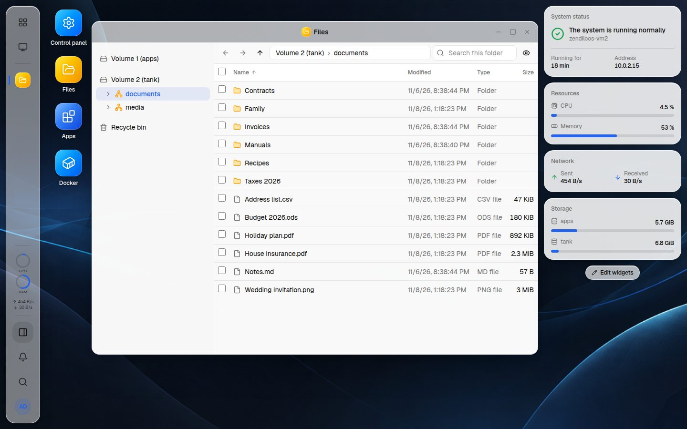
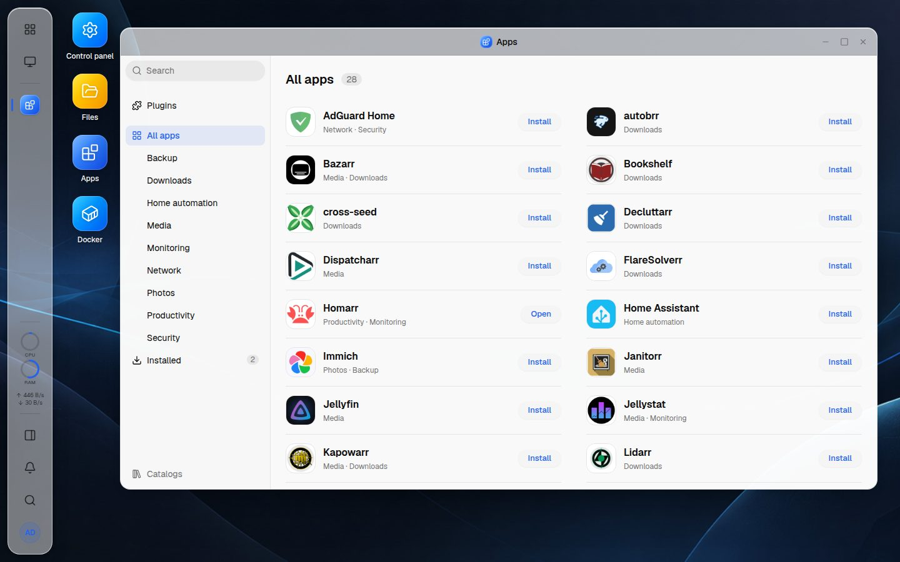

<div align="center">


# zendiloOS

_A NAS operating system on Debian, run from a desktop in the browser._

[](https://github.com/mavnezz/zendiloOS/actions/workflows/ci.yml)
[](LICENSE)
[](https://www.debian.org/releases/trixie/)

Download for [x86-64](https://github.com/mavnezz/zendiloOS/releases/latest/download/zendiloos-amd64-netinst.iso) or [arm64](https://github.com/mavnezz/zendiloOS/releases/latest/download/zendiloos-arm64-netinst.iso) ·
[Releases](https://github.com/mavnezz/zendiloOS/releases) ·
[Architecture](docs/architecture.md) ·
[Testing](docs/testing.md) ·
[Licences](docs/licences.md) ·
[Issues](https://github.com/mavnezz/zendiloOS/issues)



</div>

> [!WARNING]
> zendiloOS is young. Try it on hardware whose disks hold nothing you would miss.

## Status

zendiloOS is a preview. Every function is tested end to end in QEMU test
machines with the real tools (ZFS, Samba, NFS, Docker, libvirt), but on
real hardware it has run only on one small x86-64 board, for a few days,
and no Windows or macOS client has used its shares yet. Releases come often and may change how things behave; read
the notes before you update. What is tested and how:
[docs/testing.md](docs/testing.md). What is still to be done: the
[issues](https://github.com/mavnezz/zendiloOS/issues).

## Why zendiloOS

Your files, photos and media belong on a machine you own, and keeping it
should not take a weekend of shell sessions. zendiloOS turns a plain Debian 13
into a NAS you run from the browser: ZFS for the data, shared folders for
every device in the house, apps as Docker projects of your own, updates with
a click. Underneath it
stays Debian, and what it does to the system goes through one small,
hardened service that checks every request.

## Features

- **Storage on ZFS**: pools from mirrors to RAIDZ3 with guard rails, SMART and self-tests, scrubs, snapshots
- **Where each disk sits**: your NAS drawn with each disk in its bay and its health, from a catalog of models or a layout of your own; a disk blinks to be found; purchase and warranty noted for every disk
- **Files and shared folders**: one explorer for personal folders, the folders on each volume and removable drives; folders shared over SMB and NFS, each with access per person and group that holds at once for the whole folder, and NFS per computer; previous versions from snapshots, which Windows shows too; one recycle bin; a search through all subfolders
- **App Center**: apps from the [community catalog](https://github.com/mavnezz/zendiloOS.community.applications) and others you add, installed as Docker projects of your own that you can edit; plugins for Docker and for certificates from Let's Encrypt
- **Docker**: containers, images, networks and your own Compose projects, a page per container with its log and a terminal, image updates, with consent for whatever reaches beyond the container
- **Docker volumes**: listed with the containers that use them; backed up into a shared folder daily, weekly or monthly, as many kept as you like, the containers stopped meanwhile; restored under their own name or into another volume, also once a volume was deleted; backups found in a folder taken over again
- **Virtual machines** (preview, on x86-64): a plugin of the App Center; VMs with several disks and network cards, an image library, a console in the browser and their load live; snapshots of all their disks at once, by hand and on schedules, and backups into a share or onto a USB drive, restored as a new VM or over the old one; a TPM and Secure Boot for Windows 11; USB and PCI devices of the host handed to a VM
- **Network**: addresses per card with confirmation, bridges, bonds and VLANs; an installation of Debian with ifupdown taken over on request
- **Updates**: Debian and zendiloOS in one place, signed releases from three channels (stable, test, development)
- **Configuration backup**: accounts, shares, settings and certificates in one file encrypted with a passphrase, downloaded or written on a schedule into a share or onto a USB drive, and restored on a fresh installation instead of its first setup; the old machine's pools imported there when you ask, their shares mounted again, and its network settings and firewall rules applied one by one, each confirmed
- **Security**: two-factor sign-in, a firewall that covers Docker's published ports too, limits on failed logins, blocked addresses, sessions to end, SSH that switches itself off
- **Notifications**: in the browser, by e-mail through one mail server and by webhook, chosen per kind

<div align="center">

</div>

## Getting started

### Hardware

A machine with a disk for the system and one or more for data (SATA or
NVMe), and a network connection:

- **x86-64 (amd64)**: a NAS appliance, a mini PC or a machine of your own,
  with UEFI or a BIOS.
- **arm64**: a NAS board or single-board computer whose firmware starts a
  USB stick through UEFI (EDK2, or U-Boot's UEFI) and whose hardware
  Debian's own kernel supports; boards that need their vendor's kernel do
  not work. zendiloOS has not run on a real arm64 board yet
  ([testing](docs/testing.md#arm64)), and virtual machines are offered on
  x86-64 only for now.

### Install from the ISO

1. Download the installation ISO of the newest release for [x86-64](https://github.com/mavnezz/zendiloOS/releases/latest/download/zendiloos-amd64-netinst.iso) or [arm64](https://github.com/mavnezz/zendiloOS/releases/latest/download/zendiloos-arm64-netinst.iso), and write it to a USB stick.
2. Start the NAS from it and choose **Install zendiloOS**.
3. Answer what the installer asks: language, location and keyboard, the machine's name, root's password and the disk for the system. Everything else is set up for you; the installer needs the network.
4. After the restart the console shows the address of the web interface. Open it in a browser on your network and create the first administrator: no setup code is needed, whoever comes first sets the NAS up, so do it right away.

### Install on an existing Debian 13

```sh
sudo sed -i 's/^Components: main$/Components: main contrib/' /etc/apt/sources.list.d/debian.sources
sudo apt update && sudo apt install linux-headers-$(uname -r)
sudo apt install ./zendiloos_<version>_amd64.deb   # from a release; _arm64.deb on arm64
```

ZFS comes from Debian's `contrib` and is built for your kernel. The setup code
is on the console and in `/var/lib/zendiloos/setup-code`. Where Debian's
installer set the network up with ifupdown, Control panel → **Network**
offers to let zendiloOS manage it (the ISO does that by itself); it waits
for your confirmation and gives ifupdown everything back if none comes.

### Update

Control panel → **Updates** looks for updates daily: Debian's packages
and new releases of zendiloOS on the chosen channel. Installing is a click,
and a restart only happens when you ask for it. The page also shows what is
new in the version installed.

### Uninstall

```sh
sudo apt purge zendiloos
```

Pools, shared folders and their data stay where they are; so do Docker and
its apps. The firewall's rules go with the package. The database in
`/var/lib/zendiloos` is kept; remove it to start over.

## Development

The tools:

- **rustup.** It fetches the Rust that `rust-toolchain.toml` pins by itself.
- **Node** as `.nvmrc` pins it.
- **just, sqlx-cli for SQLite, cargo-deny and cargo-llvm-cov.**
- **Docker** for the package.
- **QEMU, xorriso, curl and jq** for the test VM and the ISO; for testing
  the arm64 ISO also QEMU for arm (`qemu-system-arm`) and its UEFI firmware
  (`qemu-efi-aarch64`).
- **minisign** to sign releases.

On Debian 13 or a recent Ubuntu:

```sh
sudo apt install build-essential pkg-config rustup docker.io \
    qemu-system-x86 qemu-utils xorriso curl jq minisign
nvm install                # Node from .nvmrc, with nvm (https://github.com/nvm-sh/nvm)
scripts/install-tools.sh   # just, cargo-deny, cargo-llvm-cov, sqlx-cli into ~/.local/bin
```

`scripts/install-tools.sh` installs the versions CI uses, prebuilt and
checked against their checksums, except sqlx-cli, which cargo builds.

```sh
just               # list all recipes
just web-install   # once, and after dependency changes: frontend packages
just check         # everything CI checks: backend and frontend
just coverage      # the tests with their coverage, against CI's thresholds
just dev           # API server on http://127.0.0.1:8780, state in dev/state
just web-dev       # interface on http://localhost:5173, talks to `just dev`
just api-types     # after API changes: regenerate the TypeScript types
just sqlx-prepare  # after changing SQL or migrations
```

On a workstation the privileged agent is simulated: nothing is changed for
real. The setup code is in `dev/state/setup-code`.

```sh
just deb           # build dist/zendiloos_*.deb in a debian:trixie container
just deb arm64     # the same for arm64, cross-compiled
just iso           # the installation ISO for it (just iso arm64 for arm64's)
just vm create     # a Debian 13 test VM with 4 SATA and 1 NVMe disk
just vm start      # boot it in the background
just vm install    # install the newest package from dist/
```

The test VM answers on https://127.0.0.1:8443. The VM tests (`just
vm-*-test`) change and destroy things and run in a second VM:
`ZENDILOOS_VM=2 just vm create` (then `start` and `install` the same way),
on https://127.0.0.1:8444. How releases are made and
signed: [docs/releases.md](docs/releases.md).

```text
backend/    Cargo workspace (crates/zendiloos-*, zendiloosd, zendiloos-agent)
frontend/   Vue 3 interface; openapi.json and the TypeScript types are generated
debian/     Debian packaging
packaging/  systemd units, nginx, default configuration, build image, ISO answers
scripts/    test VM, VM tests, release and ISO tools
docs/       architecture, testing, releases, licences
```

## License

[Apache-2.0](LICENSE). What the package carries of others' work, and under
which licences: [docs/licences.md](docs/licences.md); every release
publishes its software bill of materials beside the package.
